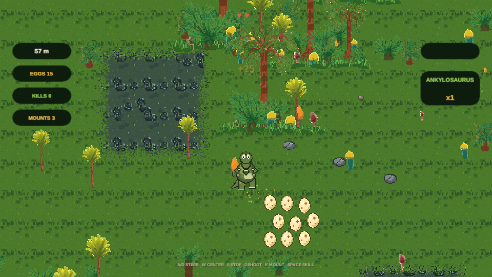

# DinoImpact 游戏体验与校招作品评估

2026-11-24，基于版本 `66bede6`。项目方希望改善 BGM 和背景同质化，提升成品感，并判断作品适合投哪些校招岗位。下文的关卡编排、美术方向和制作顺序都是待试玩验证的建议。

**DinoImpact 已经可以作为游戏客户端或玩法程序的校招主讲项目。** 玩家能够在同一片无尽地图上斜向奔跑、射击、换乘，并用不同恐龙的能力应对障碍。最值得让人记住的一句话是「我在奔跑中换了一头龙，于是下一段路有了另一种走法」。目前第一局给人的印象更接近在绿地上捡蛋、绕石头。下一轮最值得做的是把一次换乘的理由、动作和收益连成玩家能亲手完成的片段。

## 画面为什么显得重复

这张图里已经有树林、沼泽和蛋阵，最容易看出来的规律却是等距的草地横纹。草地图块只有 32×32 像素，深色草叶集中在图块的同一条边，平铺后就把整屏连成了一排排横线。建议用这张图作为改版前的对照，同一处先试三个调整。

| 画面中的问题 | 第一版怎么改 | 怎么判断有效 |
| --- | --- | --- |
| 草地重复，树林和沼泽像零散摆上去的物件 | 把深草从图块边缘移开，降低底纹对比。中央留出浅色兽径，两侧树冠聚成大块，让湿地沿低处延伸，脚印斜穿前路。 | 缩小截图，第一眼能看出路线、地标和危险的位置。 |
| 树冠细节密，骑手和多种坐骑却共用相近的身体轮廓 | 先打磨两头常用坐骑的剪影、朝向和步态，例如三角龙的宽头盾和翼龙的翼展。仓库里已有白羽坐骑跑动图，开局实际读取的是程序生成的 `mount_comps_*`，值得先对照实机选择素材。 | 遮住坐骑名，玩家仍能认出刚换的龙，也能看清前进方向。 |
| 小石头和灌木的同名精灵同时用于装饰与障碍，玩家难以预判碰撞 | 装饰石画扁、压低明暗，危险石保留突起轮廓和落地阴影。给会强制转向的灌木独特外形。 | 新玩家从静帧能指出哪些东西需要躲，碰撞结果符合预期。 |

实现位置可对照[地表与恐龙绘制](../Assets/SurfImpact/Scripts/DinoPixelArt.cs)、[装饰池](../Assets/StreamingAssets/Lua/dino_world.lua)、[障碍与坐骑配置](../Assets/StreamingAssets/Lua/dino_data.lua)和[白羽坐骑素材预览](../tools/art/preview/ornithomimus_ingame.png)。区域设计可以参考《Alto’s Odyssey》把沙丘、峡谷、神庙和各自的穿越动作配对的做法。放到 DinoImpact，玩家看见林线或岩阵，就应该开始考虑下一头坐骑。[开发团队介绍](https://altosodyssey.com/press/)

## 首局玩法与界面

**第一次换乘出现得很早，玩家缺的是换它的理由。** 开局固定在前方放一头睡着的三角龙。以 Lua 无头宿主运行 80 个随机种子，玩家保持直行，受击停住时按 W 恢复。首次出现可换乘提示的中位时间约为 2.95 秒，79 局在 10 秒内出现。这个指标只测到了进入范围的时间；玩家是否看懂提示、主动换乘，还要现场观察。[生成逻辑](../Assets/StreamingAssets/Lua/dino_track.lua)

有一处可以先修。靠近教学三角龙时，提示可能写成 `[K] MOUNT THE COMPSOGNATHUS`，因为界面取了玩家当前坐骑的名称。提示应取附近目标，并说明它能做什么，例如「K 换乘三角龙 · 可冲碎岩石」。局内的「龙名 ×1」也可以改成「空格 · 冲锋 ×1」或「幼崽护盾 ×2」。距离、生命、箭量和技能留在局内，击杀数、换乘数放到结算。标题页可以用骑手、林线和巨足投影介绍游戏，把现在首屏的技术栈说明移到作品集，把按键放到首次用到的地方。[界面与提示](../Assets/StreamingAssets/Lua/dino_ui.lua) · [换乘目标与技能](../Assets/StreamingAssets/Lua/dino_mount.lua)

建议在现有无尽生成前试做约一分钟的开场，分三段：

1. **学会转向。** 用一条弯曲蛋线引导 A/D 转向，再用一小段直线教 W 回正。回正后接着吃到蛋，玩家能立即检验自己的操作。
2. **第一次主动换乘。** 睡着的三角龙前方有两条路，外侧安全可绕，内侧的岩石后面是一串蛋。换乘、冲锋、碎石和收蛋接连发生，让玩家亲手看到换龙的收益。
3. **自己选一次路线。** 小树林出现，附近有翼龙。玩家可以保留三角龙绕林，也可以换翼龙飞越。两条路线在林后汇合，以现有的蜥脚类巨足预警和落脚收尾。

找 5 名没看过项目的人，不口头教学，记录他们是否看懂换乘提示、是否知道新坐骑能做什么、失败后想尝试哪种不同走法。有人错过三角龙时，记下当时他在看哪里、在按什么，再决定要改提示、摆位还是时机。

## BGM 与声音反馈

当前音乐是一个 16 秒循环，四个和弦各占四秒，持续音、拨弦和低音按固定节奏重复；丛林环境声另有一个 12 秒循环。菜单、普通奔跑和追逐沿用同一段配乐。射箭使用 `tick`，换乘使用 `gate`。这些结论来自合成和触发代码，混音听感仍需在目标设备上试听。[循环合成](../Assets/SurfImpact/Scripts/SurfAudio.cs) · [音效映射](../Assets/StreamingAssets/Lua/dino_config.lua)

先拿「第一次遇见巨足」试声音。平时让脚步和稀疏的木质打击乐建立奔跑节奏；足影进场前让鸟声停下，远处传来低频闷响；落脚的瞬间压低伴奏，让撞地声、树叶抖动和余响占住半秒；成功穿过后再让旋律回来。第一版可以控制在一个主题、普通与危险两层编曲，加上换乘、起飞、落脚三个专属音效。试玩时问玩家在哪一刻察觉危险，再对照当时的声音与足影时序。

## 校招怎么展示

| 投递方向 | 现阶段最有说服力的材料 |
| --- | --- |
| 客户端 / 玩法程序 | 展示玩家持续斜跑时，生成器怎样预测前方落点，让补给落在玩家路线上，同时避开树林。用一段斜跑录像配一个回归测试，讲清问题、实现和边界。[航向预测](../Assets/StreamingAssets/Lua/dino_player.lua) · [玩法测试](../tools/luatest/dino_tests.lua) |
| 客户端工程 | 用一个真实故障解释从复现到定位的过程。已有案例是 Unity 编辑器显示正常，Windows 构建因内置 shader 被剥离而绿屏。[排障记录](green-screen-fix.md) |
| 系统 / 关卡策划 | 展示同一头睡觉的龙如何同时成为换乘机会、射击目标和暴龙的猎物。若作为主讲项目，建议补上首局两条路线的对照录像、真人试玩中的一次误判，以及据此做出的修改。[坐骑交互测试](../tools/luatest/dino_tests.lua) |

作品集可用 45–60 秒实机录像串起「看到岩阵 → 换三角龙 → 冲碎岩石 → 在林前再选一次」，再用一页说明本人职责、一个技术取舍和验证结果。游戏已有七种坐骑、八类敌人，其中两三种之间发生的具体互动更适合用来展开面试。

## 评估依据与建议顺序

本次在 Wine 中运行现有 Windows 构建的临时副本，以自动输入截取局内画面；Lua 5.4 无头套件通过 158 项断言。另在干净 Wine 环境观察到菜单只有按钮、文字缺失，补入 Arial 后文字恢复。该现象的复现范围是本次 Wine 环境，分发前还需在目标 Windows 机器核对菜单、生命和箭量图标。

建议从**修正换乘提示、区分装饰和危险物**开始，再用同一段开场打磨地表、坐骑和声音。完成第一次盲测后，根据玩家卡住的位置调整，最后录制校招演示。这样每次投入都能用同一段实机画面和同一项玩家选择来检验。
